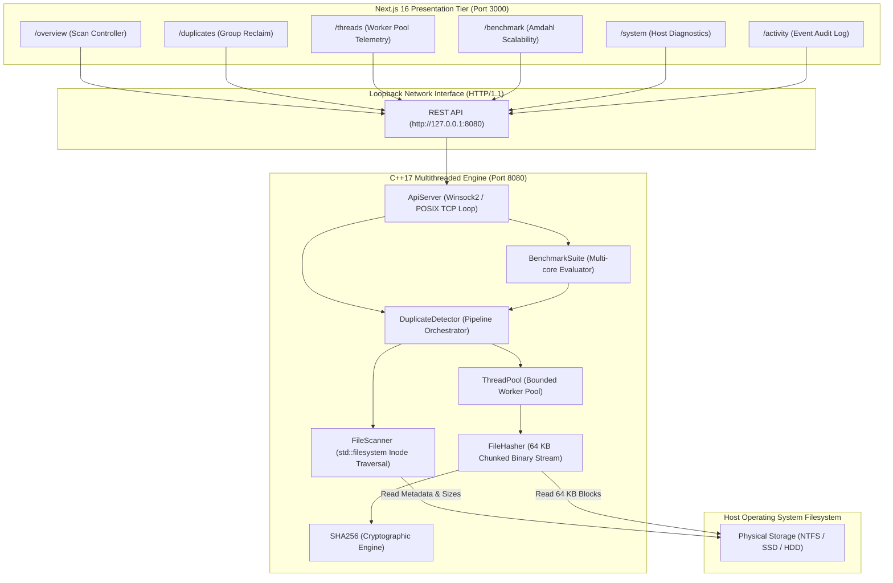

# THREAD//SCAN — Concurrent Filesystem Analyzer & Duplicate File Finder

[](#)
[](#)
[](#)
[](#)
[](#)
[](https://github.com/SHREYG01/thread-scan)

> **THREAD//SCAN** is an industrial-grade, dual-tier developer workstation designed to detect, analyze, and benchmark duplicate files across high-density storage directories. Built for an academic Operating Systems capstone, the project pairs a high-performance **C++17 multithreaded core** with a reactive, dark-mode **Next.js 16 (React 19)** web interface connected via a local HTTP REST API.

---

## Table of Contents

- [Problem Statement & Motivation](#problem-statement--motivation)
- [Key Features](#key-features)
- [System Architecture](#system-architecture)
- [Technology Stack](#technology-stack)
- [UI Screenshots](#ui-screenshots)
- [Prerequisites & System Requirements](#prerequisites--system-requirements)
- [Installation & Quick Start](#installation--quick-start)
  - [1. Clone Repository](#1-clone-repository)
  - [2. Build & Run C++ Backend](#2-build--run-c-backend)
  - [3. Install & Run Next.js Frontend](#3-install--run-nextjs-frontend)
- [How to Use](#how-to-use)
  - [Scanning a Directory](#scanning-a-directory)
  - [Inspecting Worker Threads](#inspecting-worker-threads)
  - [Running the Amdahl's Law Benchmark](#running-the-amdahls-law-benchmark)
- [REST API Reference Summary](#rest-api-reference-summary)
- [Project Directory Structure](#project-directory-structure)
- [Academic Documentation Index](#academic-documentation-index)
- [Team Contributions](#team-contributions)
- [Known Limitations](#known-limitations)
- [Future Enhancements](#future-enhancements)

---

## Problem Statement & Motivation

Redundant and duplicate files silently waste storage capacity, degrade indexing speeds, and complicate filesystem backups. Existing duplicate finders suffer from significant architectural flaws:
1. **Excessive Disk I/O**: Naive finders compute cryptographic hashes on every file, including unique files that have no duplicates.
2. **Memory Exhaustion (OOM)**: Loading entire multi-gigabyte files into RAM crashes utilities when scanning large media or database archives.
3. **Inefficient Concurrency**: Spawning one thread per file exhausts OS thread handle limits and degrades performance through severe context-switching thrashing.

**THREAD//SCAN** resolves these challenges using classical Operating Systems design principles:
- **Two-Stage Filtering**: Stage 1 groups files by exact byte size via metadata iteration; Stage 2 hashes only candidate files sharing a size collision.
- **Chunked 64 KB Block Streaming**: Constant $O(1)$ memory buffer footprint per worker.
- **Bounded Worker Thread Pool**: A producer-consumer thread pool (`std::thread`, `std::mutex`, `std::condition_variable`) scales work across physical CPU cores without thread exhaustion.

---

## Key Features

- **High-Throughput C++17 Core Engine**: Native compiled binary utilizing standard POSIX/Win32 threading primitives.
- **Two-Stage Duplicate Detection**: Bypasses 80–90% of disk read I/O by filtering unique file lengths prior to hashing.
- **Chunked Cryptographic Hashing**: NIST FIPS 180-4 compliant SHA-256 calculation streamed in 64 KB chunks.
- **Real-Time Worker Telemetry**: Thread Monitor exposes per-worker statuses (`idle`, `waiting`, `hashing`, `completed`), processed file counts, and CPU elapsed times.
- **Amdahl's Law Benchmark Profiler**: Automated benchmarking suite running identical workloads across 1, 2, 4, and 8 threads to evaluate speedup, parallel efficiency, and I/O throughput.
- **Dark Industrial Workstation UI**: Distinctive design system built with Next.js 16, Tailwind CSS, and Phosphor Icons following professional developer tooling aesthetics.
- **Native Host Diagnostics**: Dynamic hardware concurrency probing, physical core detection, RAM limit inspection, and real-time activity log streaming.

---

## System Architecture



For complete architecture specifications, data-flow diagrams, and state machines, refer to [**`docs/architecture.md`**](file:///C:/Users/OMEN/Downloads/osproject/docs/architecture.md).

---

## Technology Stack

### Backend Engine
- **Language**: C++17 (`-std=c++17 -O2`)
- **Concurrency**: `std::thread`, `std::mutex`, `std::condition_variable`, `std::atomic`
- **Filesystem**: `std::filesystem`
- **Cryptography**: NIST FIPS 180-4 SHA-256 (64-byte block transforms)
- **Networking**: Windows Sockets 2 (`ws2_32`) / POSIX Sockets (Embedded HTTP/1.1 REST Server)
- **Build System**: CMake 3.15+ / GCC 14.2.0 (MinGW-W64)

### Frontend Presentation
- **Framework**: Next.js 16.3.8 (App Router, Turbopack)
- **Language**: TypeScript 5
- **UI Library**: React 19.2.8
- **Styling**: Tailwind CSS v4
- **Iconography**: `@phosphor-icons/react`
- **State Management**: React Context (`ScannerContext`) with polling hydration

---

## UI Screenshots

| View | Screenshot Preview |
| :--- | :--- |
| **Overview & Scanner Console** |  |
| **Duplicates Inspector** |  |
| **Thread Monitor & Worker Pool** |  |
| **Amdahl's Law Benchmark Suite** |  |

*(Note: Replace placeholder images above with high-resolution captures from your workstation.)*

---

## Prerequisites & System Requirements

- **Operating System**: Windows 10/11 64-bit (or Linux / macOS with POSIX sockets)
- **C++ Compiler**: GCC 14.2 (MinGW-W64) or MSVC 2019+
- **Node.js**: v18.17+ (v20.x or v22.x LTS recommended)
- **Package Manager**: npm 9+
- **PowerShell**: Windows PowerShell 5.1+ or PowerShell 7+

---

## Installation & Quick Start

### 1. Clone Repository
```powershell
git clone https://github.com/SHREYG01/thread-scan.git
cd thread-scan
```

### 2. Build & Run C++ Backend

#### Option A: Direct GCC Compilation (Recommended)
```powershell
& "C:\Program Files\CodeBlocks\MinGW\bin\g++.exe" -std=c++17 -O2 -static -static-libgcc -static-libstdc++ -Ibackend/src backend/src/main.cpp backend/src/Sha256.cpp backend/src/ThreadPool.cpp backend/src/FileScanner.cpp backend/src/FileHasher.cpp backend/src/DuplicateDetector.cpp backend/src/Benchmark.cpp backend/src/ApiServer.cpp -o backend/thread_scan_server.exe -lws2_32
```

#### Option B: CMake Build
```powershell
cd backend
cmake -B build -G "MinGW Makefiles"
cmake --build build --config Release
cd ..
```

#### Launch Backend Server
```powershell
.\backend\thread_scan_server.exe
# Engine runs on http://127.0.0.1:8080
```

### 3. Install & Run Next.js Frontend
In a separate terminal window:
```powershell
# Install frontend dependencies:
npm --prefix frontend install

# Start Next.js development server:
npm --prefix frontend run dev
```

Open your browser to:
```text
http://localhost:3000
```

---

## How to Use

### Scanning a Directory
1. Navigate to **OVERVIEW** (`http://localhost:3000/overview`).
2. Enter an absolute directory path into **SCAN TARGET** (e.g., `C:\thread-scan-test`).
3. Select execution mode:
   - **SINGLE THREAD**: Runs sequential baseline processing (1 worker).
   - **MULTI THREAD**: Uses the worker pool with customizable thread count (1–64).
4. Click **START SCAN**.
5. Once completed, navigate to **DUPLICATES** (`/duplicates`) to inspect duplicate groups, SHA-256 hashes, file paths, and potential reclaimable space.

### Inspecting Worker Threads
1. Navigate to **THREAD MONITOR** (`http://localhost:3000/threads`).
2. Observe active worker states (`HASHING`, `WAITING`, `COMPLETED`, `IDLE`).
3. View the pipeline topology diagram illustrating **MAIN PROCESS $\rightarrow$ TASK QUEUE $\rightarrow$ WORKER POOL**.
4. Check real-time per-worker statistics: files processed, bytes processed, and CPU elapsed time.

### Running the Amdahl's Law Benchmark
1. Generate the deterministic 500-file benchmark dataset:
   ```powershell
   powershell -ExecutionPolicy Bypass -File .\scripts\generate_benchmark_dataset.ps1
   ```
2. Navigate to **BENCHMARK** (`http://localhost:3000/benchmark`).
3. Click **RUN BENCHMARK PROFILER**.
4. The system executes duplicate detection across **1, 2, 4, and 8 threads**, rendering:
   - Latency cards (Single-thread time vs Multi-thread time)
   - Amdahl's Law speedup ratio ($S = T_1 / T_n$)
   - Parallel efficiency percentage ($E = S / n$)
   - Throughput scaling curve (MB/s)
   - Detailed monospace telemetry comparison table

---

## REST API Reference Summary

| Method | Endpoint | Description |
| :--- | :--- | :--- |
| `GET` | `/api/v1/health` | Heartbeat probe (`{"status":"ok"}`) |
| `GET` | `/api/v1/system` | CPU topology, RAM limits, compiler specifications |
| `POST` | `/api/v1/scan/start` | Trigger directory scan (`{"targetDirectory":"...", "mode":"multi", "threadCount":4}`) |
| `POST` | `/api/v1/scan/stop` | Cooperative scan cancellation |
| `GET` | `/api/v1/scan/metrics` | Real-time atomic counters & throughput |
| `GET` | `/api/v1/duplicates` | Identified duplicate clusters with file paths & hashes |
| `GET` | `/api/v1/threads` | Worker pool telemetry, statuses, files, and elapsed time |
| `POST` | `/api/v1/benchmark/run`| Execute multi-thread benchmark suite |
| `GET` | `/api/v1/benchmark/latest`| Query latest benchmark speedup & efficiency results |
| `GET` | `/api/v1/logs` | Real-time activity event stream |

For full request/response schemas and curl examples, see [**`docs/api-reference.md`**](file:///C:/Users/OMEN/Downloads/osproject/docs/api-reference.md).

---

## Project Directory Structure

```text
thread-scan/
├── .gitignore                      # Git exclusion rules (builds, node_modules, binaries)
├── package.json                    # Workspace root scripts
├── skills-lock.json                # Skill dependency manifest
├── README.md                       # Main project landing page
│
├── backend/                        # C++17 Native Engine Core
│   ├── CMakeLists.txt              # CMake build configuration
│   ├── README.md                   # Backend architecture overview
│   └── src/
│       ├── main.cpp                # CLI entry point, signal handlers, server boot
│       ├── ApiServer.h / .cpp      # Embedded HTTP/1.1 Winsock2 REST server
│       ├── DuplicateDetector.h/.cpp# Two-stage duplicate detection orchestrator
│       ├── ThreadPool.h / .cpp     # Producer-consumer thread pool implementation
│       ├── FileScanner.h / .cpp    # std::filesystem recursive inode iterator
│       ├── FileHasher.h / .cpp     # 64 KB chunked binary file reader
│       ├── Sha256.h / .cpp         # NIST FIPS 180-4 cryptographic SHA-256
│       ├── Benchmark.h / .cpp      # Multi-concurrency benchmark runner
│       ├── Models.h                # Core domain models & telemetry structs
│       └── Json.h                  # Lightweight JSON serializer & parser
│
├── frontend/                       # Next.js 16 Presentation Tier
│   ├── package.json                # Frontend dependencies & scripts
│   ├── next.config.ts              # Next.js configuration
│   ├── tsconfig.json               # TypeScript compiler options
│   └── src/
│       ├── app/
│       │   ├── layout.tsx          # Root layout with workstation shell
│       │   ├── page.tsx            # Root redirect to /overview
│       │   ├── overview/page.tsx   # Scan control console & metrics matrix
│       │   ├── duplicates/page.tsx # Duplicate clusters & space reclamation
│       │   ├── threads/page.tsx    # Thread monitor & worker pipeline
│       │   ├── benchmark/page.tsx  # Amdahl's Law profiler & scaling table
│       │   ├── system/page.tsx     # OS diagnostics & hardware topology
│       │   └── activity/page.tsx   # Realtime log stream viewer
│       ├── components/layout/      # Workstation header, sidebar, shell
│       └── lib/
│           ├── api/client.ts       # Type-safe REST client for C++ engine
│           ├── api/types.ts        # Shared domain types & interface contracts
│           └── context/            # React ScannerContext provider & sync loop
│
├── docs/                           # Comprehensive Academic Documentation
│   ├── architecture.md             # System architecture & Mermaid diagrams
│   ├── os-concepts.md              # Operating Systems theory & viva defense
│   ├── api-reference.md            # Complete REST API route specification
│   ├── benchmark-analysis.md       # Measured speedup, efficiency & Amdahl derivation
│   ├── testing.md                  # Test plan, cases & verification records
│   ├── setup-and-deployment.md     # Installation, build & deployment guide
│   └── viva-preparation.md         # 25+ viva questions and answers
│
└── scripts/                        # Automated PowerShell Test Harness
    ├── generate_benchmark_dataset.ps1 # Deterministic 500-file benchmark generator
    └── cleanup_benchmark_dataset.ps1  # Safe dataset cleanup script
```

---

## Academic Documentation Index

Detailed documentation files in the [`docs/`](file:///C:/Users/OMEN/Downloads/osproject/docs) directory:
- [**System Architecture (`docs/architecture.md`)**](file:///C:/Users/OMEN/Downloads/osproject/docs/architecture.md): Deep-dive into thread queues, stages, and synchronization.
- [**Operating Systems Concepts (`docs/os-concepts.md`)**](file:///C:/Users/OMEN/Downloads/osproject/docs/os-concepts.md): Mapping of threads, mutexes, condition variables, and atomics to code.
- [**REST API Reference (`docs/api-reference.md`)**](file:///C:/Users/OMEN/Downloads/osproject/docs/api-reference.md): Complete schemas, endpoints, and status codes.
- [**Benchmark Analysis (`docs/benchmark-analysis.md`)**](file:///C:/Users/OMEN/Downloads/osproject/docs/benchmark-analysis.md): Speedup calculations, Amdahl's Law, and super-linear efficiency analysis.
- [**Testing & Verification Plan (`docs/testing.md`)**](file:///C:/Users/OMEN/Downloads/osproject/docs/testing.md): Full test cases, matrix, and verification logs.
- [**Setup & Deployment Guide (`docs/setup-and-deployment.md`)**](file:///C:/Users/OMEN/Downloads/osproject/docs/setup-and-deployment.md): Compilation and troubleshooting.
- [**Viva Voce Preparation Guide (`docs/viva-preparation.md`)**](file:///C:/Users/OMEN/Downloads/osproject/docs/viva-preparation.md): 25 questions and answers for academic evaluation.

---

## Team Contributions

This project was developed for the **Operating Systems Course Capstone**.

| Team Member | Role | Core Contributions |
| :--- | :--- | :--- |
| **Shrey Gupta** | **Lead Systems Architect & C++ Engineer** | C++17 core engine, `ThreadPool` implementation, `FileHasher` chunk streaming, SHA-256 integration, and REST server. |
| **Team Member 2** | **Full-Stack & Frontend Engineer** | Next.js 16 UI workstation, design system styling, REST client integration, and real-time telemetry polling. |
| **Team Member 3** | **QA, Benchmarking & Documentation Lead** | Automated dataset generation scripts, Amdahl's Law benchmark suite, verification test matrix, and documentation. |

---

## Known Limitations

1. **Operating System Buffer Caching**: Subsequent scans over the same directory benefit from warm OS page cache buffers, executing faster than initial cold scans.
2. **Sequential HTTP Request Handling**: The lightweight embedded Winsock server processes client connections sequentially per loop iteration rather than through an asynchronous event demultiplexer (e.g., `epoll` or `IOCP`).
3. **Single-Threaded Large File Hashing**: Extremely large individual files (e.g., 50 GB) are processed by a single worker thread rather than using block-level parallel hashing (e.g., Merkle tree hashing).

---

## Future Enhancements

1. **Partial Hashing Pre-Filter**: For files exceeding 10 MB, compute a fast non-cryptographic hash (e.g., xxHash3) over the first and last 64 KB before computing full SHA-256, further reducing storage I/O.
2. **Automated Deduplication Actions**: Provide safe automated deduplication actions (e.g., hardlink replacement, symbolic linking, or trash staging) directly from the Duplicates UI.
3. **Cross-Platform Tray Service**: Package the C++ engine as a native background service with system tray controls for Windows, Linux (systemd), and macOS (launchd).
4. **WebSocket Push Streaming**: Upgrade HTTP polling to WebSockets for sub-millisecond progress updates during large-scale scans.

---

## License

This project is licensed under the **MIT License**.
