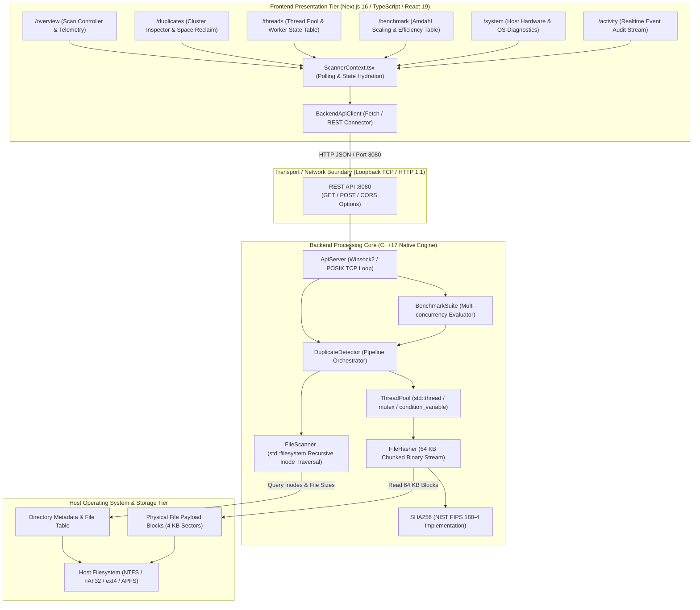
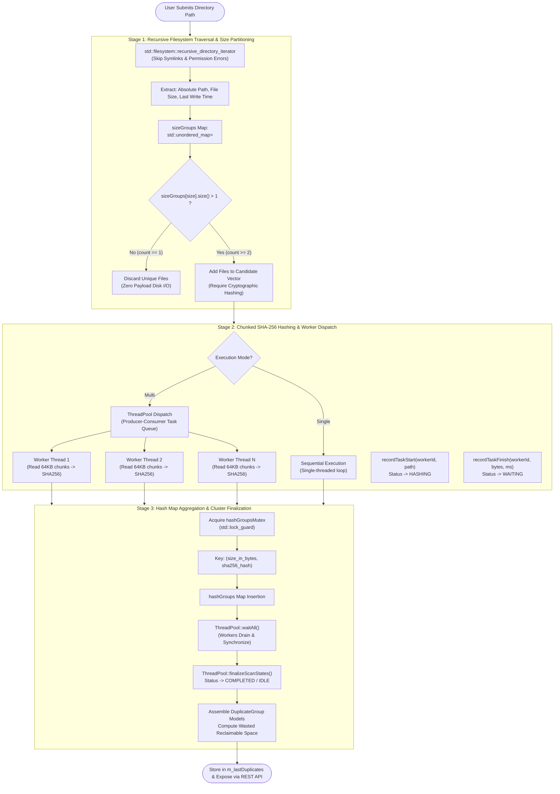
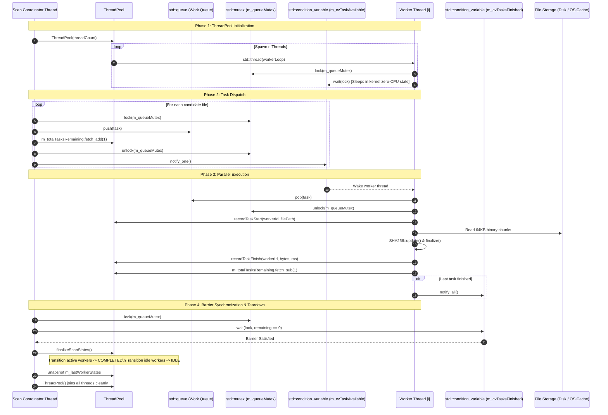

# THREAD//SCAN — System Architecture Specification

## 1. Executive Summary & Design Philosophy

**THREAD//SCAN** is a specialized, dual-tier filesystem analysis workstation engineered to identify duplicate files across high-density storage directories. The system marries an industrial, low-latency **C++17 native backend** with a reactive, dark-workstation **Next.js 16 (React 19)** web interface.

The design philosophy prioritizes **strict operating systems resource efficiency**:
1. **Never read file payloads unnecessarily**: Files with unique byte sizes across an entire directory tree cannot possibly be duplicates; they are discarded in Stage 1 without reading disk blocks.
2. **Never allocate unconstrained memory buffers**: File hashing employs chunked 64 KB block streaming, preventing Out-Of-Memory (OOM) faults on gigabyte-scale datasets.
3. **Never spawn unconstrained OS threads**: Operating systems impose substantial thread creation and context-switching overhead. THREAD//SCAN utilizes a bounded **producer-consumer worker thread pool** bounded by hardware concurrency or user preference.
4. **Decoupled execution via HTTP/REST**: The native C++ engine operates as an independent daemon serving synchronous REST endpoints over loopback TCP sockets (`127.0.0.1:8080`), maintaining clean architectural boundaries.

---

## 2. High-Level Architecture Topology



---

## 3. Frontend / Backend Separation & Inter-Process Communication

### 3.1 Network Transport Contract
- **Protocol**: HTTP/1.1 over TCP loopback (`http://127.0.0.1:8080`).
- **Data Encoding**: Strict UTF-8 JSON payloads with RFC-compliant headers (`Content-Type: application/json; charset=utf-8`).
- **CORS Handling**: Native CORS headers (`Access-Control-Allow-Origin: *`, `Access-Control-Allow-Methods: GET, POST, OPTIONS, PUT, DELETE`) supported directly in C++ via `ApiServer::makeCorsOptionsResponse()`.
- **Latency Profile**: Sub-millisecond loopback latency; non-blocking HTTP worker model ensuring UI responsiveness.

### 3.2 State Synchronization & Telemetry Polling
The presentation tier (`ScannerContext.tsx`) manages continuous hydration without WebSocket overhead using an adaptive polling schedule:
1. **Health & Initial State Hydration (3,000 ms cadence)**:
   - Queries `GET /api/v1/health` to confirm engine availability.
   - Queries `GET /api/v1/system` to fetch hardware processor count and memory limits.
   - Queries `GET /api/v1/duplicates` and `GET /api/v1/benchmark/latest` on initial connection.
2. **Realtime Telemetry Loop (800 ms cadence during active connection)**:
   - Polls `GET /api/v1/scan/metrics` for atomic counters (`filesDiscovered`, `filesProcessed`, `bytesProcessed`, `wastedBytes`).
   - Polls `GET /api/v1/threads` for per-worker states (`idle`, `waiting`, `hashing`, `completed`), elapsed times, and currently processed files.
   - Polls `GET /api/v1/logs` for real-time daemon event audit streams.

---

## 4. End-to-End Duplicate Detection Pipeline



### 4.1 Stage 1: Filesystem Traversal & Candidate Partitioning
- **Component**: [`FileScanner.cpp`](file:///C:/Users/OMEN/Downloads/osproject/backend/src/FileScanner.cpp#L40-L87)
- **Input**: Directory root path (`std::string`), minimum file size threshold (`uint64_t`).
- **Mechanism**:
  - Leverages `std::filesystem::recursive_directory_iterator` configured with `std::filesystem::directory_options::skip_permission_denied`.
  - Filters out directories, sockets, FIFOs, and symbolic links (`entry.is_regular_file() && !entry.is_symlink()`) to prevent infinite recursion and circular links.
  - Normalizes paths using `entry.path().lexically_normal().string()`.
  - Formats modification timestamps (`entry.last_write_time()`) using thread-safe time conversion (`localtime_s` on Win32, `localtime_r` on POSIX).
  - Groups files into `std::unordered_map<uint64_t, std::vector<FileEntry>>` indexed by file size.
- **Complexity**:
  - Time Complexity: $\mathcal{O}(N)$ where $N$ is the total file count.
  - Space Complexity: $\mathcal{O}(N)$ storing lightweight `FileEntry` metadata structures (path, name, ext, size, time).

### 4.2 Stage 2: Parallel Task Queue & Chunked SHA-256 Hashing
- **Components**: [`ThreadPool.cpp`](file:///C:/Users/OMEN/Downloads/osproject/backend/src/ThreadPool.cpp), [`FileHasher.cpp`](file:///C:/Users/OMEN/Downloads/osproject/backend/src/FileHasher.cpp), [`Sha256.cpp`](file:///C:/Users/OMEN/Downloads/osproject/backend/src/Sha256.cpp)
- **Mechanism**:
  - Filters `sizeGroups`: Only size groups containing $\ge 2$ files are submitted as candidates.
  - Task unit: A lambda closure capturing the candidate `FileEntry` and worker assignment index.
  - Chunked read loop:
    ```cpp
    std::vector<char> buffer(64 * 1024); // 64 KB block
    while (file.read(buffer.data(), buffer.size()) || file.gcount() > 0) {
        sha.update(reinterpret_cast<const uint8_t*>(buffer.data()), file.gcount());
        m_bytesProcessed.fetch_add(file.gcount());
    }
    ```
  - Lock decoupling: The task queue mutex is **never held during file I/O or SHA-256 computation**. Workers acquire the lock only for microsecond task dequeue operations.

### 4.3 Stage 3: Duplicate Cluster Aggregation
- **Component**: [`DuplicateDetector.cpp`](file:///C:/Users/OMEN/Downloads/osproject/backend/src/DuplicateDetector.cpp#L206-L235)
- **Grouping Key**:
  ```cpp
  struct GroupKey {
      uint64_t size;
      std::string hash;
      bool operator==(const GroupKey& o) const {
          return size == o.size && hash == o.hash;
      }
  };
  ```
- **Reclaimable Space Formula**:
  For each duplicate group $G$ containing $k$ files of identical size $S$:
  $$\text{Wasted Bytes} = S \times (k - 1)$$
  The primary master file is retained; only the $k-1$ redundant replicas constitute reclaimable space.

---

## 5. Thread Pool & Concurrency Pipeline Sequence

The following sequence diagram details the synchronization lifecycle between the main REST scan worker thread, the worker thread pool, and OS synchronization primitives:



---

## 6. Shared State & Synchronization Inventory

| Shared Resource | C++ Primitive | Scope | Invariant / Thread Safety Rationale |
| :--- | :--- | :--- | :--- |
| **Work Task Queue** | `std::queue<std::function<void(int)>>` protected by `std::mutex m_queueMutex` | `ThreadPool` | Prevents race conditions during simultaneous queue push/pop. Replaced by `std::condition_variable` notifications. |
| **Task Availability** | `std::condition_variable m_cvTaskAvailable` | `ThreadPool` | Prevents worker threads from busy-waiting or burning CPU cycles when no work exists. |
| **Task Completion Barrier** | `std::condition_variable m_cvTasksFinished` | `ThreadPool` | Provides a barrier unblocking `waitAll()` only when `m_totalTasksRemaining == 0`. |
| **Worker State Array** | `std::vector<WorkerThreadState>` protected by `std::mutex m_statesMutex` | `ThreadPool` | Ensures telemetry read/write operations for worker state, processed counts, and elapsed time remain atomic. |
| **Discovered Inodes** | `std::atomic<uint64_t> m_filesDiscovered` | `FileScanner`, `DuplicateDetector` | Lock-free lockless increment accessible concurrently by progress callbacks and telemetry GET queries. |
| **Processed Files** | `std::atomic<uint64_t> m_filesProcessed` | `DuplicateDetector` | Lock-free atomic increment tracking completed candidate files. |
| **Processed Bytes** | `std::atomic<uint64_t> m_bytesProcessed` | `FileHasher`, `DuplicateDetector` | Lock-free atomic counter updated as 64 KB blocks are read. |
| **Cancellation Flag** | `std::atomic<bool> m_stopRequested` | `DuplicateDetector` | Polled by scanning iterators and worker loops to guarantee responsive, thread-safe cancellation. |
| **Collision Results Map** | `std::unordered_map<GroupKey, ...>` protected by `std::mutex hashGroupsMutex` | `DuplicateDetector` | Synchronizes thread-safe writes of computed hashes from concurrent worker tasks into duplicate groups. |
| **API Server Audit Logs** | `std::vector<ActivityLogEvent>` protected by `std::mutex m_dataMutex` | `ApiServer` | Guarantees ordered log event recording with a 200-event ring-buffer prune ceiling. |

---

## 7. Error Handling & Fault Isolation

1. **Filesystem Traversal Errors**:
   - `std::filesystem::directory_options::skip_permission_denied` bypasses restricted directories without aborting the walk.
   - Per-entry `try ... catch` blocks ignore locked, transient, or corrupt inodes without terminating scanner threads.
2. **File Access & I/O Failures**:
   - If `std::ifstream::open()` fails (e.g., file locked exclusively by another process), `FileHasher` returns an empty string `""`.
   - The detector checks `if (!hash.empty())` before inserting into collision maps, preventing unreadable files from corrupting groups.
3. **Task Queue Worker Protection**:
   - Every worker loop encapsulates task execution in `try ... catch (...)` guards. If an unexpected exception occurs inside a work unit, the worker catches it, decrements remaining task counts, and remains alive to process subsequent work units.
4. **Network & Client Socket Disconnections**:
   - Winsock read loops handle partial reads, empty requests, and sudden client disconnects gracefully via `closesocket()`, preventing socket descriptor leaks.
